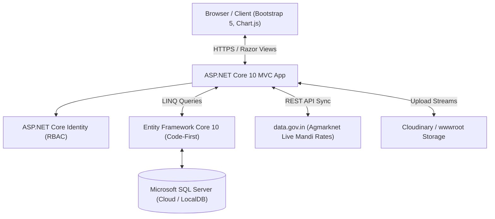
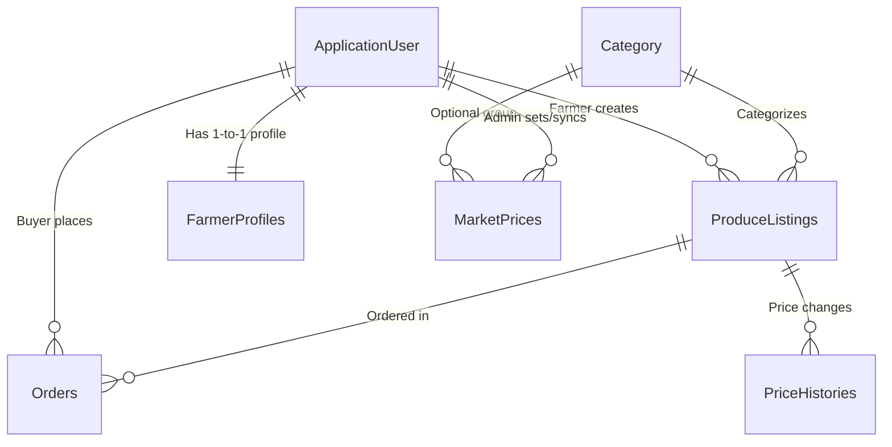

# 🌾 AgriLink — Direct Farmer-to-Buyer Agricultural Marketplace

[](https://dotnet.microsoft.com/)
[](https://dotnet.microsoft.com/apps/aspnet)
[](https://learn.microsoft.com/ef/core/)
[](https://www.microsoft.com/sql-server)
[](LICENSE)

**AgriLink** is a modern, full-stack ASP.NET Core MVC web application connecting local agricultural producers (farmers) directly with wholesale and consumer buyers. By eliminating intermediary middlemen and commission agents, farmers earn fair prices for their produce while buyers access fresh, locally harvested crops with verified farm profiles and historical price trend analytics.

---

## 🌟 Key Features

### 👨‍🌾 1. For Farmers
* **Farmer Identity & Farm Profile:** Create and maintain a verified digital farm presence with farm size (acres), years of experience, farm location, biographical details, and farm branding photos.
* **Harvest Listing Management (CRUD):** List produce with title, category, quantity, measurement unit, harvest date, location, and photos.
* **Instant Status & Stock Toggle:** Toggle produce status between `Available` and `Sold Out` or allow the system to auto-manage stock.
* **Order Management Dashboard:** Review incoming buyer orders with direct `Accept`, `Reject`, or `Complete` status workflows.
* **Automatic Stock Restore:** If an accepted order is subsequently cancelled or rejected, reserved stock is automatically returned to the active inventory.

### 🛒 2. For Buyers
* **Public Marketplace Catalogue:** Search produce by name, keywords, or location, and filter dynamically by category and price range ($Min/Max$).
* **Flexible Sorting:** Sort produce by newest listings, price (low-to-high / high-to-low), and harvest dates.
* **Interactive Produce Details & Price Trends:**
  * **Chart.js Price Visualization:** Interactive historical price curve illustrating listing price adjustments over time.
  * **Daily Mandi Market Benchmark:** Real-time benchmark comparisons against official commodity rates (e.g., Tomato, Onion, Wheat) via live Government Agmarknet integration.
  * **Farmer Transparency Card:** View complete producer credentials directly beside the produce before ordering.
* **Direct Order Placement:** Live quantity validation ensuring requested order quantities do not exceed current available inventory.
* **"My Orders" Tracking:** Live order tracking across `Pending`, `Accepted`, `Rejected`, and `Completed` fulfillment states.

### 🛡️ 3. For Administrators
* **Category Management:** Full CRUD management for agricultural categories with custom categorization.
* **Live Mandi Benchmark Sync (`data.gov.in`):** Integration with the official Government Agmarknet API to ingest daily minimum, maximum, and modal mandi reference prices across districts and states.
* **Manual Override Protection:** Ability to manually edit or add benchmark prices with protection against automated sync overwrites.
* **Platform Governance:** Comprehensive supervision of registered platform users, individual produce listings, and platform-wide orders.

---

## 🏗️ System Architecture & Tech Stack



* **Framework:** ASP.NET Core 10.0 (C#)
* **Design Pattern:** Model-View-Controller (MVC) + ViewModels
* **Database ORM:** Entity Framework Core 10.0 (Code-First, Fluent API)
* **Database Engine:** Microsoft SQL Server (LocalDB / Cloud MS SQL)
* **Authentication & Authorization:** ASP.NET Core Identity with Role-Based Access Control (`Farmer`, `Buyer`, `Admin`)
* **Front-end:** Razor Pages/Views, HTML5, CSS3, Bootstrap 5, Chart.js
* **Cloud & Media Storage:** Hybrid Cloudinary CDN with fallback to local disk storage
* **Third-Party APIs:** Open Government Data Platform India (`data.gov.in`) Agmarknet API
* **CI/CD & Containerization:** Docker (Multi-stage build), GitHub Actions / Render Web Service

---

## 🗄️ Database Schema Overview



* **`ApplicationUser`:** Extends `IdentityUser` with `FullName`, `Address`, and `CreatedAt`.
* **`FarmerProfile`:** 1-to-1 extension of `ApplicationUser` using a shared primary key constraint (`UserId`).
* **`Category`:** Broad crop classification (`Vegetables`, `Fruits`, `Grains & Pulses`, `Spices`).
* **`Produce`:** Harvest listings with quantity validation, units, pricing, location, and status.
* **`Order`:** Transactional records capturing quantity ordered, total price, and fulfillment status.
* **`PriceHistory`:** Automatic audit log created whenever a farmer edits a listing's price.
* **`MarketPrice`:** Daily commodity reference rate capturing commodity name, modal price, min/max mandi rates, and data source (`Manual` or `Agmarknet`).

---

## 🚀 Getting Started

### Prerequisites
* [.NET 10.0 SDK](https://dotnet.microsoft.com/download/dotnet/10.0)
* [SQL Server](https://www.microsoft.com/sql-server) (LocalDB, Express, or Cloud instance)
* [Visual Studio 2022](https://visualstudio.microsoft.com/) / [VS Code](https://code.visualstudio.com/) / JetBrains Rider

### Installation & Local Setup

1. **Clone the Repository:**
   ```bash
   git clone https://github.com/solanki-vimal/AgriLink.git
   cd AgriLink
   ```

2. **Configure Connection String:**
   Update `AgriLink/appsettings.json` with your database connection:
   ```json
   "ConnectionStrings": {
     "DefaultConnection": "Server=(localdb)\\mssqllocaldb;Database=AgriLinkDb;Trusted_Connection=True;MultipleActiveResultSets=true"
   }
   ```
   *(Or use .NET User Secrets to keep passwords private:)*
   ```bash
   dotnet user-secrets set "ConnectionStrings:DefaultConnection" "<your-connection-string>" --project AgriLink
   ```

3. **Apply Database Migrations:**
   ```bash
   dotnet ef database update --project AgriLink
   ```

4. **Run the Application:**
   ```bash
   dotnet run --project AgriLink
   ```
   Navigate to `https://localhost:7123` or `http://localhost:5123` in your browser.

---

## ⚙️ Configuration & Environment Variables

| Variable | Description | Default / Example |
| :--- | :--- | :--- |
| `ConnectionStrings__DefaultConnection` | SQL Server database connection string | `Server=...;Database=...;` |
| `MarketPrices__State` | Default State for Agmarknet Mandi API sync | `Gujarat` |
| `MarketPrices__TrackedCommodities` | Array of default commodities tracked | `["Tomato", "Onion", "Potato", ...]` |
| `Cloudinary__CloudName` | *(Optional)* Cloudinary Cloud Name for cloud images | `""` *(falls back to local disk)* |
| `Cloudinary__ApiKey` | *(Optional)* Cloudinary API Key | `""` |
| `Cloudinary__ApiSecret` | *(Optional)* Cloudinary API Secret | `""` |

---

## 🐳 Docker Deployment

The application includes a multi-stage `Dockerfile` optimized for minimal image size and fast cloud deployments:

```bash
# Build the Docker image
docker build -t agrilink:latest .

# Run the container
docker run -p 8080:8080 -e ConnectionStrings__DefaultConnection="<your-db-conn-str>" agrilink:latest
```

---

## 👥 Contributors

* [**Vimal Solanki**](https://github.com/solanki-vimal)
* [**Hanuj Trivedi**](https://github.com/Hanuj007)
* [**Khushi**](https://github.com/khushii3319)

---

## 📄 License
This project is open-source and available under the [MIT License](LICENSE).
